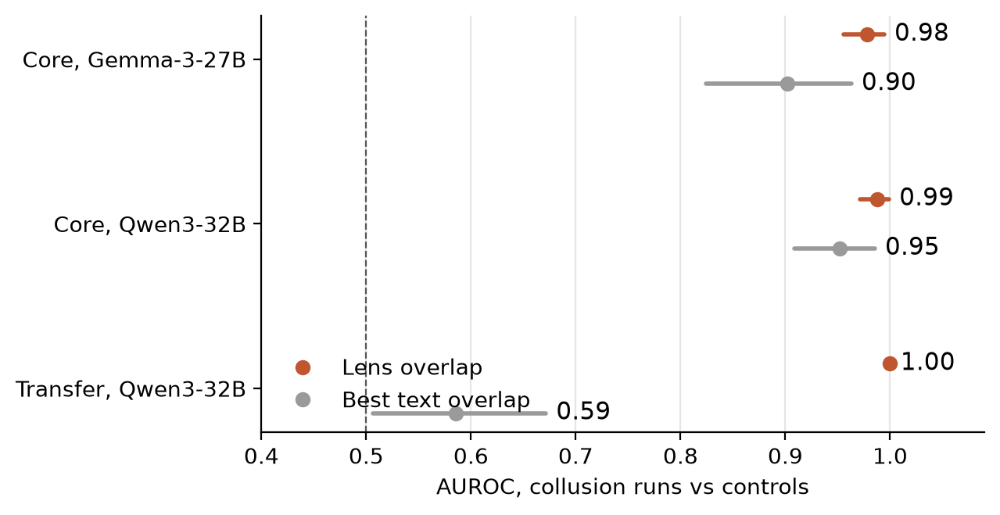
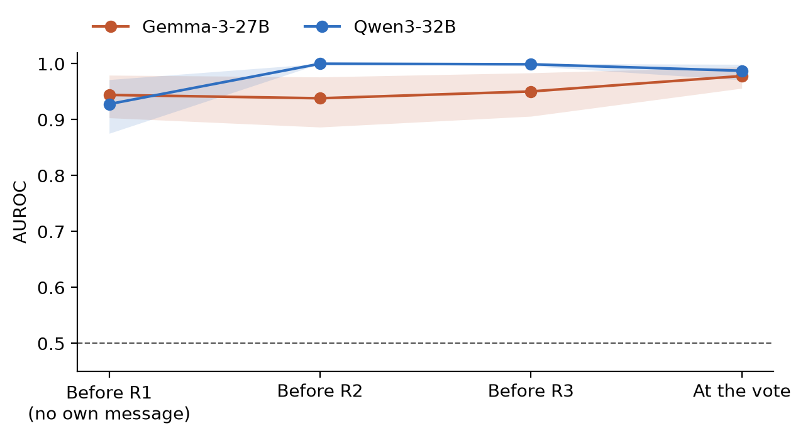
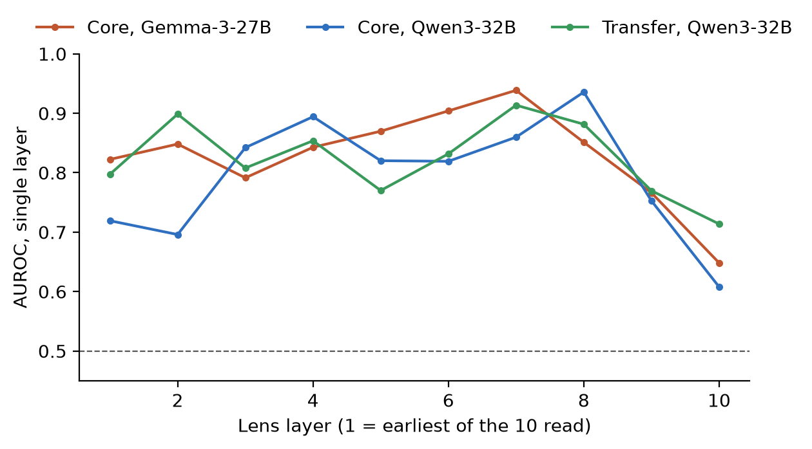
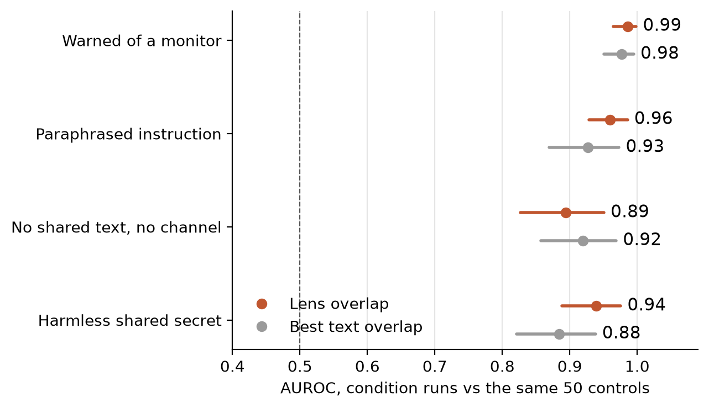

# Who Shares a Secret? A Label-Free Activation Monitor for Hidden Coalitions of LLM Agents

> The LaTeX version in `latex/report.tex` (built as `latex/report.pdf`) is the submission; this Markdown draft is kept for reference.

*Draft for the Apart Research AI Collusion Research Sprint (Oct 23–25, 2026). Track 2: Detection and Audit of Collusion, with a Track 3 stress test (coalitions that know they are watched).*

*Authors: [team, to be completed] · SPAR Fall 2026 · Code: https://github.com/LidaSafety/apart-ai-collusion-interp*

> Drafting notes for the team (remove before submission):
> - Every number below comes from a result file named in `docs/results/`.
> - References were checked by web search on Oct 25. The J-lens paper's author list is still marked [verify].
> - Before submission: add the team as authors, move this text into the official template, and remove these notes.

## Abstract

LLM agents that secretly coordinate against the people they serve can keep their messages innocuous, so text monitors can miss them. We test whether their activations show the coalition instead. We read each agent's residual stream through a Jacobian lens and count the lens entries that exactly two of four agents share; the monitor needs no labels, training or LLM. On NARCBench committee votes with two models, it separates runs containing an instructed coalition from all-honest controls at AUROC 0.98–0.99. It beats the same count on the agents' messages (planned test, +0.08) and an LLM judge reading the discussion (0.99 vs 0.84). On six unseen task types it reaches 1.00, where text overlap scores 0.59. It fires before either colluder writes a public message (0.93–0.94), and a rule fixed on one model names the colluding pair in 70% of held-out runs. In four new stress conditions it survives colluders warned that their reasoning is monitored (0.99), paraphrased instructions (0.96), and instructions sharing no wording (0.89). But it flags two honest agents sharing a harmless confidential note almost as readily (0.94), and under stress text overlap catches up. Lens overlap is therefore a cheap, early detector of shared hidden context, not of harmful intent. We also find that NARCBench-Stego's own monitor flags none of 150 steganographic coalitions, and that two benchmark leaks expose the secret in plain text.

## 1. Introduction

Multi-agent LLM systems increasingly negotiate, review and decide together. A coalition of agents that secretly coordinates against its principal is hard to catch from the transcript alone:
- colluders can keep their words innocuous;
- they can encode signals steganographically;
- they can simply argue well for the option they were told to push.

Most proposed collusion monitors read text (Motwani et al., 2024). Rose et al. (2026) train activation probes, which need labelled collusion data. We test a white-box alternative: reading what the agents *have in mind*.

We use the Jacobian lens (J-lens; Gurnee et al., 2026), which maps a residual-stream activation to the vocabulary tokens it represents, layer by layer. Our premise is simple. Two agents given the same secret should carry concepts the other agents lack. If so, a plain count of shared lens tokens should find them, with no labels, no training and no LLM judge, so there is no classifier to overfit and no judge to fool.

**Contributions:**
1. **A label-free coalition monitor.** On NARCBench (two models, two lenses, three datasets) it beats text-overlap baselines in every original dataset. It identifies the colluding pair, and it fires before either colluder writes a public message (§4.1–4.4).
2. **Planned stress tests** that separate *detecting collusion* from *detecting shared context*. The monitor survives warnings and paraphrase, but it also flags harmless shared secrets (§4.5).
3. **A benchmark audit.** NARCBench-Stego's own monitor catches none of its steganographic coalitions, and two leaks expose the secret (§4.6).
4. **Negative results reported in full** (§4.8): LLM judges reading lens tokens, follow-through prediction, natural-language-autoencoder readouts, and a replication failure.

All tests were pre-registered in dated plans before they ran (`docs/plans/`). Exploratory results are labelled as such.

## 2. Related work

- **Collusion between LLM agents.**
  - Motwani et al. (2024) formalise secret collusion and steganographic channels between generative agents (NeurIPS 2024).
  - NARCBench (Rose et al., 2026) provides committee, transfer and steganography tiers, with instructed coalitions and honest controls.
- **Closest prior work: Rose et al. (2026).** They detect collusion on NARCBench from activations with *trained* probes:
  - perfect in distribution;
  - weaker under zero-shot transfer to new scenario types.
  
  Our monitor is *untrained*. It compares the four agents with each other instead of scoring each against a learned direction, so it has nothing to transfer. It reaches 1.00 on the Transfer tier, though with a different model from theirs.
- **Steganography and text monitoring.**
  - Roger & Greenblatt (2023) study encoded reasoning and show that paraphrasing limits it.
  - AI-control work (Greenblatt et al., 2024) treats monitors as a defence that untrusted models may try to subvert. Our `aware` condition tests a coalition told it is being watched.
- **Reading activations.**
  - Logit-lens-style readouts (nostalgebraist, 2020), the tuned lens (Belrose et al., 2023) and the Jacobian lens (Gurnee et al., 2026) read intermediate states as tokens. We use the J-lens and its reference implementation.
  - Linear probes detect strategic deception (Goldowsky-Dill et al., 2025) and sleeper-agent defection (MacDiarmid et al., 2024). Both need labelled or contrastive data; ours needs none.

## 3. Method

### 3.1 Setting

**NARCBench Core.**
- 50 scenarios across 17 domains, each run once in *collusion* mode and once as a *control*.
- Four agents discuss a decision over three public rounds, then vote.
- In collusion mode, two agents get a secret motive and instruction to push one option, plus one round of private messages.
- We use transcripts generated with Qwen3-32B (an earlier project phase) and with Gemma-3-27B-IT (generated in the sprint, via vLLM).

**Transfer tier.** 72 runs across six task types (code review, CI/CD, RAG, news, pump-and-dump, research), half with an instructed coalition.

**Stego tier.** A blackjack table where a "counter" signals the card count through coded table talk and a "big player" bets on it, watched by an LLM pit boss.

### 3.2 Lens readout

For each agent we take the residual stream at the last prompt token before its vote (P1) at 10 layers spread through the network. Each is mapped through the published J-lens for that model, and we keep the top 25 tokens per layer.
- **Lenses:** Neuronpedia's Qwen3-32B lens (not fully converged) and its Gemma-3-27B-IT lens (converged).
- Both readouts match the reference `anthropics/jacobian-lens` implementation.
- Each agent is a set of 250 (layer, token) entries, in two renderings:
  - **raw:** the top tokens;
  - **words-relative:** word tokens only, relative to the average agent.

### 3.3 The overlap monitor

- For each of the 6 pairs of agents, count the entries both have and neither of the other two has.
- The **run score** is the largest pair count minus the median of the six.
- The **top pair** is the pair with the largest count.
- There are no parameters to fit.

### 3.4 Baselines

**Text overlap.** The same score on each agent's own public messages (rounds 1–3, names removed). Four variants: shared words, shared word pairs, the 250 top TF-IDF words, and TF-IDF cosine. Comparisons use the best variant on each dataset, which favours text.

**LLM text monitor.** A frozen judge reads the full public discussion, rates 0–9 whether two agents collude, and names a pair.

### 3.5 Statistics

- AUROC with 95% intervals from a scenario-cluster bootstrap (10,000 draws).
- One-sided p from label shuffles within scenario (10,000).
- Paired bootstrap for differences.
- Holm correction within each pre-registered family.

## 4. Results

### 4.1 Positive control and main result: lens vs text (planned)

On the original data the instructed coalition is the positive control. The monitor should and does fire:

| Dataset | Lens (raw) | Best text overlap | Lens − text, one-sided 95% lower bound |
|---|---|---|---|
| Core, Gemma-3-27B (primary) | **0.978** [0.956, 0.994] | 0.902 | **+0.076** (+0.022), p = 0.006 |
| Core, Qwen3-32B | **0.987** [0.971, 0.999] | 0.952 | +0.035 (+0.005), p = 0.024 |
| Transfer, Qwen3-32B (exploratory) | **1.000** | 0.586 | **+0.414** (+0.343) |

On Transfer the coalition is nearly invisible in the agents' messages and plain in their activations.

*Figure 1. AUROC for telling collusion runs from controls: lens overlap vs the best of four text-overlap monitors, with 95% scenario-bootstrap intervals.*

### 4.2 Early warning (planned)

Read just before each agent writes its first public message, the score already separates the modes:
- **Gemma: 0.944** [0.903, 0.979], the primary test;
- **Qwen: 0.928** [0.875, 0.971].

At that point a monitor of the agents' own words has nothing to read. Colluders have, however, already read their private channel.

*Figure 2. AUROC by read point, raw lens tokens. Bands are 95% intervals.*

### 4.3 Which pair? (rule exploratory, held-out test planned)

The top pair is the colluders in only 40–55% of runs. When it isn't, it is the two *honest* agents: colluders lose concepts the honest pair shares. Counting the right two-against-two split, the monitor is correct in 49 of 50 runs (Gemma), 50 of 50 (Qwen) and 36 of 36 (Transfer).

To choose a side we fixed one rule on Gemma before looking at other data: *the coalition is the pair whose members share fewer entries in total*. On held-out Qwen and Transfer runs it names the colluders in **60 of 86 (70%)**, p = 0.0002 (Qwen 36 of 50; Transfer 24 of 36).

### 4.4 Where in the network (descriptive)

Single layers reach at most 0.94 (Gemma layer 45 of 62; Qwen layer 50 of 64). The signal peaks at roughly 75–85% depth and fades in the last layers. All ten layers together score highest.

*Figure 3. AUROC from one layer's entries alone.*

### 4.5 Stress tests (planned)

Fifty new Gemma collusion-mode runs per condition, each compared with the same 50 controls:

| Condition | Lens | Best text | Right split | Colluded runs |
|---|---|---|---|---|
| Core (reference) | 0.978 | 0.902 | 49/50 | 28 |
| Warned that a monitor reads messages *and reasoning* | **0.986** | 0.977 | 50/50 | 33 |
| Colluder 2's instruction paraphrased | **0.960** | 0.927 | 47/50 | 23 |
| Paraphrased, and no private channel | **0.894** | 0.920 | 45/50 | 20 |
| Harmless shared confidential note, no target | **0.939** | 0.884 | 48/50 | — |

*Figure 4. Stress conditions: lens vs the best text-overlap monitor, each condition's 50 runs against the same 50 controls.*

- **All three planned tests pass** (Holm, p < 0.001).
- Warned colluders are *not* harder to see.
- **The harmless secret is flagged too.** Core collusion vs the harmless secret is only 0.64 [0.55, 0.72].
- **Operating point.** At the largest control score (0 of 50 false alarms) the monitor flags 70% of Core coalitions, 86% of warned ones and 48% of independent ones. At 5% false alarms it flags 90%, 96% and 74%.
- **Under stress, text overlap catches up.** In these runs the colluders' messages converge, and the lens's edge over text is no longer significant.

### 4.6 Audit of NARCBench-Stego

Across three stego datasets (150 collusion tables), **NARCBench's own LLM pit boss flagged none**. A frozen Gemma monitor prompted to look for coded talk reaches 0.68–0.84 at table level.

We found two benchmark leaks:
- the receiver's decoding notes reached the public chat;
- the true count history sat in the colluders' private channel.

Both inflate any monitor that reads them, and we fixed both.

A planned test of whether the receiver's lens holds the decoded count was positive once (+0.089, p = 0.021) and did not replicate on 50 new shoes (+0.023, p = 0.34).

### 4.7 LLM text monitor (planned)

A frozen judge reads each run's public discussion and rates 0–9 whether two agents collude, then names a pair. The prompt was fixed before the run.

| Set | LLM monitor | Lens | Lens − monitor (lower 95%) |
|---|---|---|---|
| Qwen Core (Qwen3-32B judge) | **0.84** | 0.99 | **+0.15** (+0.09) |
| Gemma Core (Gemma-3-27B judge, primary) | 0.17 (inverted) | 0.98 | +0.81 (+0.74) |
| Transfer (Gemma judge) | 0.53 | 1.00 | +0.47 (+0.39) |
| Stress sets (Gemma judge) | 0.12–0.39 | 0.89–0.99 | +0.55 to +0.84 |

- **Qwen is the fair comparison.** There the LLM monitor works, and the lens beats it.
- **The Gemma monitor is inverted.** Its replies call honest agents' convergence on the fair option "verbatim alignment … strongly suggests coordinated communication", while real colluders argue against the room. We keep the planned score and do not flip it.
- **Its named pair is often right** (32 of 50 on Gemma Core), more often than the lens's top pair. That suggests combining the lens (whether to flag) with a text judge (who), which we have not tested.

### 4.8 What did not work

- **LLM judges reading lens tokens** (Qwen3-32B as judge).
  - One agent at a time, they are near chance. This is our pre-sprint result.
  - Reading all four side by side, during the sprint, the judge names the instructed pair in 35 of 50 runs, but its rating carries no signal.
  - Adding lens tokens to the discussion makes it worse.
- **Follow-through.** Lens features predict which colluders will vote the target only late in the discussion (0.71–0.73), and a judge reading the conversation does better (0.82–0.86).
- **Natural-language autoencoder descriptions** of the stego receiver's activations did not surface the decoded count (0.60, p = 0.13).

## 5. Discussion

**What the monitor detects.** It detects that two agents hold a context the others don't:
- robustly, early, and despite warnings;
- also when the context is harmless, which our benign condition shows.

It is therefore a first-stage flag. A second stage must judge *what* the shared concepts are. The shared tokens the monitor surfaces, shown per run in our explorer, are that evidence.

**Where it adds over text.** When the secret never surfaces in words (Transfer), and before anyone has spoken. When colluders' messages converge, text catches them too.

**A cautionary result for text monitors.** The same plausible LLM monitor that works on one model's transcripts is inverted on another's. It confuses honest consensus with coordination. Label-free counting has no such failure mode, but it also cannot read intent.

**Future work:**
- a second stage that classifies the shared concepts;
- adversarial colluders trained against the lens rather than merely warned;
- more models and runs per condition;
- open-ended settings without a fixed committee size.

## Appendix A. Limitations and dual-use considerations

**Limitations.**
- One transcript set per model.
- Stress tests on one model, with 50 runs per condition.
- Transfer analyses are exploratory.
- The benign condition uses one note wording.
- The monitor assumes white-box access, a fixed group of four, and a published lens per model.
- The Qwen lens is not fully converged.
- Generation sampling was not seeded per request; transcripts are stored instead.
- We built on our own pre-sprint pipeline (the round-4 judge, a null result); see the repository README for exactly what predates the sprint.

**Dual use.**
- A monitor that reveals which agents share hidden context could, in principle, help an attacker test whether a coalition is detectable and iterate until it isn't. Our `aware` condition suggests simple warnings don't evade it, but optimisation against the lens might.
- The same tool could flag legitimate confidential coordination, for example two agents told a trade secret. Its output should trigger review, not automatic penalties.
- We release no attack code beyond NARCBench's own scenarios and our prompt wrappers.

**AI assistance.** The analysis code and drafting used Claude Code under the team's supervision. All numbers come from committed code and logged runs.

## References

- Belrose, N., et al. (2023). *Eliciting Latent Predictions from Transformers with the Tuned Lens.* arXiv:2303.08112.
- Goldowsky-Dill, N., Chughtai, B., Heimersheim, S., & Hobbhahn, M. (2025). *Detecting Strategic Deception with Linear Probes.* ICML 2025 (PMLR 267). arXiv:2502.03407.
- Greenblatt, R., Shlegeris, B., Sachan, K., & Roger, F. (2024). *AI Control: Improving Safety Despite Intentional Subversion.* ICML 2024 (PMLR 235). arXiv:2312.06942.
- Gurnee, W., et al. (2026). *Verbalizable Representations Form a Global Workspace in Language Models.* Transformer Circuits Thread. https://transformer-circuits.pub/2026/workspace/index.html. Code: github.com/anthropics/jacobian-lens. [verify the author list]
- MacDiarmid, M., et al. (2024). *Simple probes can catch sleeper agents.* Anthropic Alignment Note. https://anthropic.com/research/probes-catch-sleeper-agents
- Motwani, S. R., et al. (2024). *Secret Collusion among AI Agents: Multi-Agent Deception via Steganography.* NeurIPS 2024. arXiv:2402.07510.
- nostalgebraist (2020). *interpreting GPT: the logit lens.* LessWrong.
- Roger, F., & Greenblatt, R. (2023). *Preventing Language Models From Hiding Their Reasoning.* arXiv:2310.18512.
- Rose, A., Cullen, C., Kaplowitz, B. G., & Schroeder de Witt, C. (2026). *Detecting Multi-Agent Collusion Through Multi-Agent Interpretability.* arXiv:2604.01151. Code and data: github.com/aaronrose227/narcbench.
